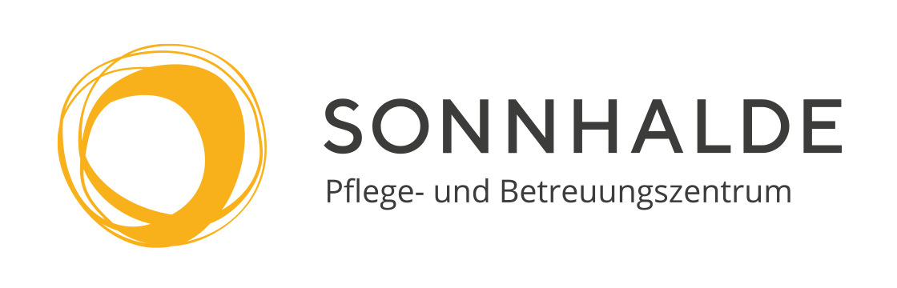
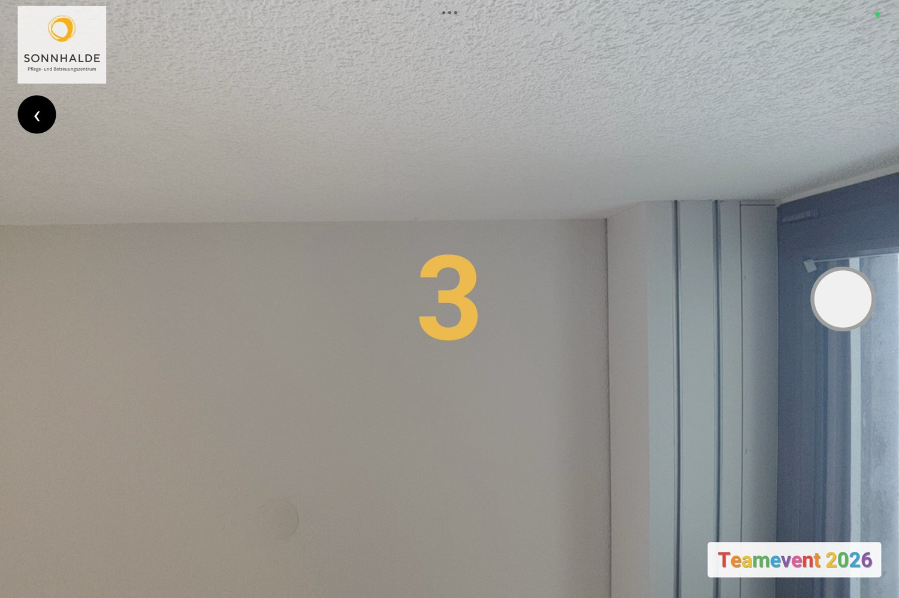
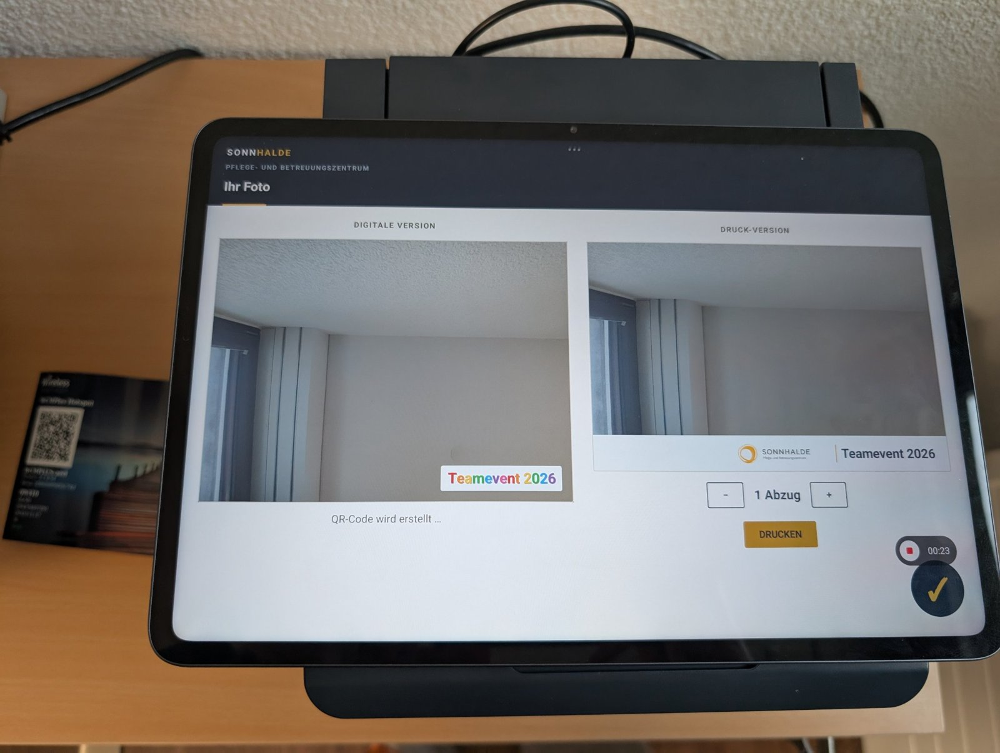
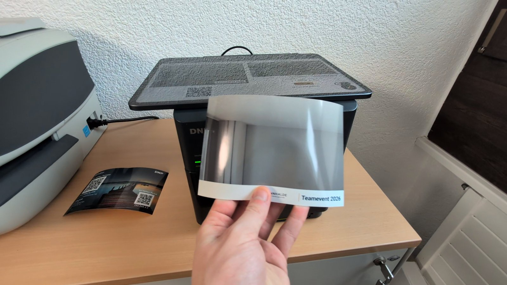

# Sonnhalde Fotobox

Android-App für eine Fotobox am Tablet: Gäste lösen ein Foto mit Timer aus, bekommen einen **QR-Code zum Herunterladen**
und können das Foto auf einem **DNP QW410** (mit WCMPlus-WLAN-Modul) **ausdrucken**. Entwickelt für das Pflege- und
Betreuungszentrum Sonnhalde AG als Ersatz für die UpReach-Fotobox. Die App braucht keine Cloud eines Herstellers.

## So sieht es aus

| Timer vor dem Foto | Tablet auf dem Drucker | Fertiger Abzug |
|---|---|---|
|  |  |  |

Dokumentation für Dritte:

| Dokument | Inhalt |
|---|---|
| [docs/EINRICHTUNG.md](docs/EINRICHTUNG.md) | Einsatz vor Ort: Checkliste, Netz (Gast-WLAN mit Wechsel zum Drucker), WCMPlus, Upload, Kiosk, Fehlersuche, Datenschutz, Wartung |
| [docs/BEDIENUNG.md](docs/BEDIENUNG.md) | Bildschirme und Knöpfe der App (Setup- und Retail-Modus) |
| [docs/nextcloud.md](docs/nextcloud.md) | Upload nach Nextcloud einrichten |
| [docs/power-automate-flow.md](docs/power-automate-flow.md) | Upload nach SharePoint über Power Automate |
| [docs/RELEASE.md](docs/RELEASE.md) | Release mit APK veröffentlichen (Workflow, Versionsschema) |
| [docs/ENTWICKLUNG.md](docs/ENTWICKLUNG.md) | Technik, Gerätefakten, Entscheidungen, offene Punkte (für Entwickelnde) |

## Funktionen

- **Setup-Modus** (Einrichtung): Reiter **Konfiguration**, **Kamera**, **Drucker**, **Warteschlange**, **WLAN**. Unten der grosse
  **Start**-Knopf, oben ⏻ = App beenden (nach PIN).
- **Retail-Modus** (Gäste, Kiosk/Vollbild): Startbildschirm (Hintergrundbild, Logo, Überschrift, Start-Knopf) → Live-Kamera →
  Timer (3, 5 oder 10 s) → Ergebnis mit **QR-Code** («Zum Herunterladen scannen»), Anzahl Abzüge (1–3) und **DRUCKEN**.
  Nach 90 s ohne Eingabe geht es zurück zum Start.
- **Foto und Banner:** Pro Foto entstehen zwei Bilder: die **Druck-Version** (3:2, 10 × 15 cm, Banner unten mit Logo mittig und frei
  wählbarem Text links und rechts, je max. 28 Zeichen) und die **digitale Version** (Originalformat, Banner optional). Hochgeladen wird
  die digitale, gedruckt die Druck-Version. Im Setup (Reiter Konfiguration) einstellbar: **Textfarbe** (Schwarz, Gold, Navy, Regenbogen),
  **eigenes Logo** (PNG/JPG; «Standard-Logo» stellt das Sonnhalde-Logo wieder her), **Transparenz** des Banner-Hintergrunds (0–100 %;
  bei 100 % steht der Banner unter dem Foto, darunter liegt er durchscheinend auf dem Foto) und **Banner auf der digitalen Version** (ein/aus).
- **QR-Code:** Das Foto wird nach **Nextcloud** oder **SharePoint** (Power Automate) hochgeladen; der Freigabe-Link wird als QR-Code
  angezeigt. Schlägt der Upload fehl, wartet das Foto in der **Warteschlange** und kann später erneut gesendet werden.
- **Druck:** Direkt per IPP an den QW410, kein Android-Druckdialog nötig (als Ausweg gibt es einen Knopf dafür). Optional wechselt die
  App zum Drucken kurz ins Drucker-WLAN und danach zurück.
- **Kiosk:** Vollbild, Zurück-Taste gesperrt, Bildschirm bleibt an; Beenden nur mit PIN.

- **Foto-Hintergrund** (wie bei Teams): Im Setup (Reiter Konfiguration, «Foto – Hintergrund») wählt die Betreiberin bzw. der Betreiber ein Bild aus,
  z. B. einen Wald. Die Personen werden auf dem Tablet freigestellt (ML Kit, ohne Internet, nichts wird hochgeladen) und vor dieses Bild gesetzt.
  Mitgeliefert sind Platzhalter in den Sonnhalde-Farben; eigene Bilder lassen sich aus der Galerie hinzufügen und löschen. Das Live-Bild zeigt
  weiterhin den echten Hintergrund, der neue erscheint im fertigen Foto (Druck und QR-Code). Schlägt die Erkennung fehl, wird das Originalfoto verwendet.

Nicht vorhanden (UpReach hat es): Video/GIF-Hintergrund, E-Mail-Versand.

## Voraussetzungen

- Android-Tablet mit **Android 10 oder neuer** (Mindestversion der App: API 29). Getestet wurde auf einem Xiaomi-Tablet.
- **DNP QW410** mit **WCMPlus**-Modul (WLAN-Druckmodul).
- Internetzugang für den Upload (und damit den QR-Code), ein Nextcloud-Konto oder ein Power-Automate-Flow.

## Installation und Update

1. Auf der **Release-Seite** dieses Repositorys die neueste Version öffnen und die APK-Datei auf das Tablet laden.
   `dev-build` ist ein automatisches Vorab-Release (wird bei jedem Entwicklungsstand überschrieben); für den Einsatz die
   nummerierten Releases verwenden (erstes echtes Release: `v0.1.36`). Neue Releases werden per Knopfdruck in GitHub erstellt: [docs/RELEASE.md](docs/RELEASE.md).
2. APK öffnen und installieren (Android verlangt einmalig die Erlaubnis «Installation aus unbekannten Quellen» für die App, mit der
   die Datei geöffnet wurde).
3. **Update:** neue APK einfach über die installierte App installieren, die Einstellungen bleiben erhalten. Alle Builds sind mit
   demselben Schlüssel signiert. **Ältere Builds davor (anders signiert) einmalig deinstallieren.**
4. Die installierte Version steht im Setup oben («Aktive Konfiguration: SONNHALDE · Version 0.1.N (Commit)»).

## Kurz-Einstieg in 5 Schritten

1. **App installieren** (siehe oben) und öffnen. Es erscheint der Setup-Modus.
2. **Drucker einrichten:** WCMPlus-Modul und Tablet so verbinden, dass beide erreichbar sind (siehe [docs/EINRICHTUNG.md](docs/EINRICHTUNG.md), Abschnitt Netz),
   dann *Setup → Drucker* → Druckformat 4x6 wählen → **Testdruck**.
3. **Upload einrichten:** *Setup → Konfiguration → Upload-Ziel* → Nextcloud ([docs/nextcloud.md](docs/nextcloud.md)) oder SharePoint
   ([docs/power-automate-flow.md](docs/power-automate-flow.md)) → **Upload testen**, QR-Code mit dem Handy scannen.
4. **Anpassen:** Banner-Text, Überschrift, Hintergrund, Timer unter *Setup → Konfiguration*; **PIN ändern** (Standard `1234`).
5. **Start** drücken (Retail-Modus). Beenden: langer Druck auf Logo bzw. Banner, dann PIN.

## Kiosk-Modus

- **Mit Device Owner (empfohlen):** volle Sperre ohne Rückfrage; einmalig per ADB (Gerät ohne Konten, ohne anderen Device Owner
  wie UpReach): `adb shell dpm set-device-owner ch.sonnhalde.fotobox/.kiosk.AdminReceiver`
- **Ohne Device Owner:** Android «Bildschirm fixieren» (einmalige Rückfrage, Ausstieg per Systemgeste).

Mehr dazu in [docs/EINRICHTUNG.md](docs/EINRICHTUNG.md).

## Hintergrund, Logo

Dateien in `app/src/main/res/drawable-nodpi/`: `sonnhalde_logo.png` (Banner), `sonnhalde_logo_vertical.png`, optional
`start_background.jpg` (Standard-Hintergrund; ein im Setup gewähltes Bild hat Vorrang). Austausch der Datei genügt, danach neu bauen.

## Build (für Entwickelnde)

`./gradlew assembleDebug` (Android SDK 34, JDK 17). GitHub Actions baut bei jedem Push die APK, prüft sie und stellt sie als
Vorab-Release `dev-build` bereit. Alle Builds nutzen den bewusst eingecheckten (nicht geheimen) `app/debug.keystore`.

## Sicherheit

Zugangsdaten (Nextcloud-App-Passwort, Flow-URL, WLAN-Passwort, PIN) liegen unverschlüsselt im App-Speicher des Tablets. Eigene Zugänge
mit minimalen Rechten verwenden und nie ins Repository einchecken.

Hinweis: UpReach ist kommerzielle, lizenzierte Software und diente nur als Vorbild für Aussehen und Ablauf.
